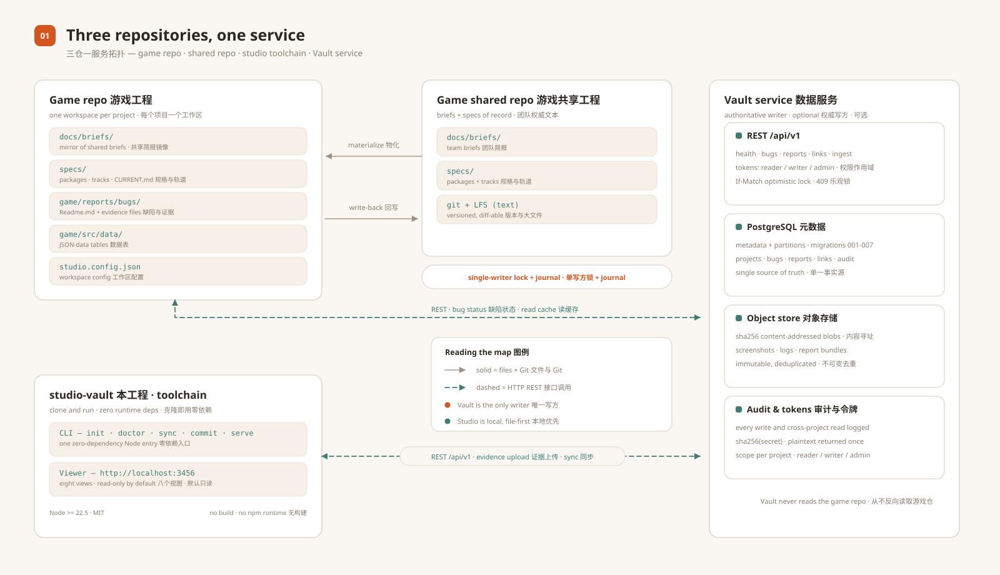
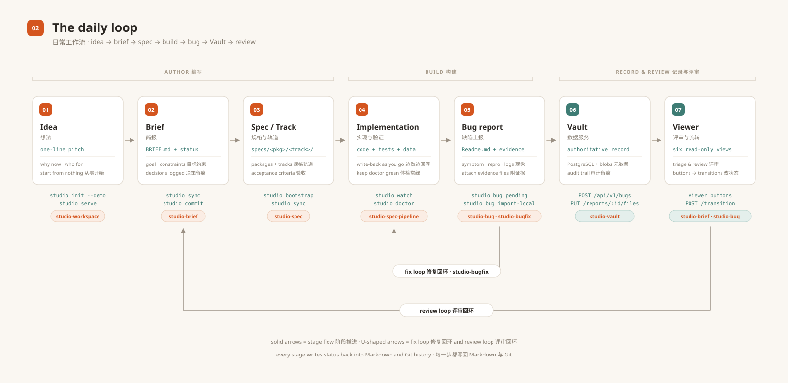
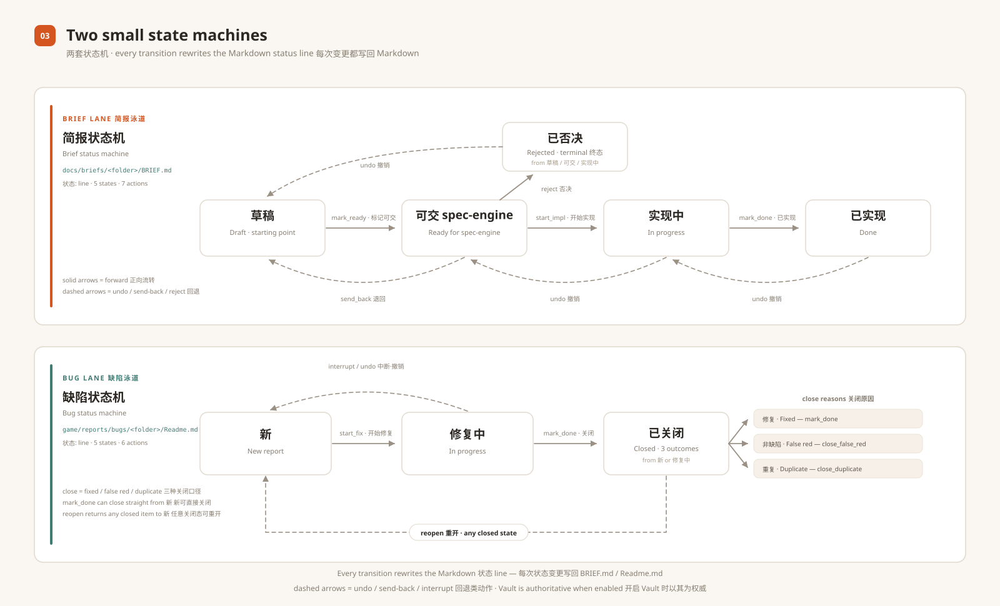
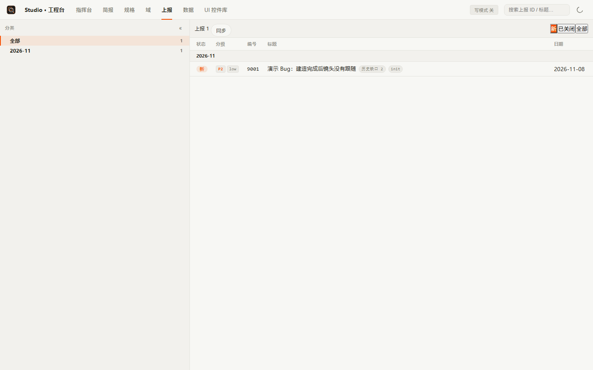
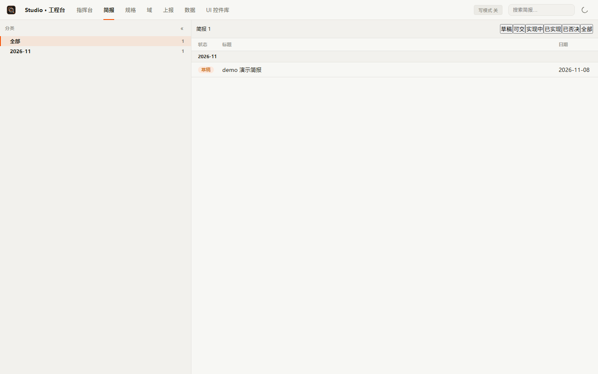
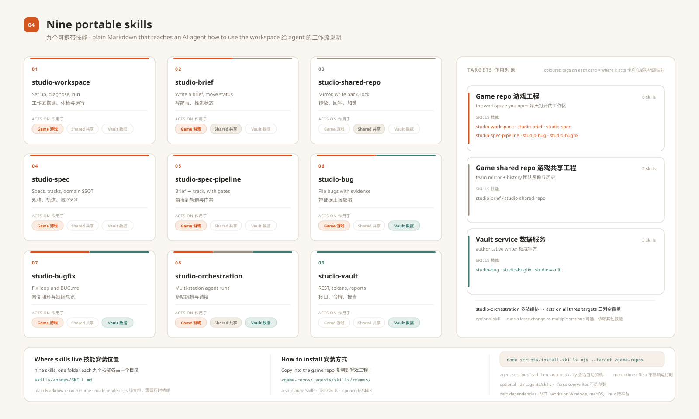

# Studio & Vault

**A zero-dependency workflow and data toolkit for game teams.**

Studio turns the everyday artefacts of a game project — briefs, spec docs, bug
packages and data tables — into a workflow you can browse on your machine and
review in Git. Vault is the companion service for the heavy material
(screenshots, logs, report bundles): PostgreSQL metadata, sha256
content-addressed object storage and a small REST API.

English · [中文](README.zh-CN.md) · MIT · Node.js standard library only

---

## One picture: three repositories and one service



| Box | What it is | You set it up |
|---|---|---|
| **This repo — studio-vault** | The toolchain: the `studio` CLI and a zero-dependency viewer server. Clone it and run — no build, no install, no runtime dependencies. | once |
| **Game repo** | Your project repository. Briefs live in `docs/briefs/`, specs in `specs/`, bug packages in `game/reports/bugs/`, data tables in `game/src/data/`. | per project |
| **Game shared repo** | Optional team-level repository that holds briefs and specs. Studio materialises it into the game repo and writes changes back through a single-writer lock + journal. | per team |
| **Vault service** | Optional data service. Bug tickets and evidence become database rows plus content-addressed objects behind a REST API. | per organization |

The three rules that keep it simple:

1. **Files are the review surface.** A brief is a folder with a `BRIEF.md`; a
   bug is a folder with a `Readme.md` plus its evidence. Every status change is
   written back into Markdown, so `git log` is your audit trail.
2. **Vault is the authority when enabled.** Bug tickets and report packages get
   one authoritative writer; the Markdown copy in the game repo is a display
   cache that Studio keeps in sync.
3. **Everything degrades gracefully.** No shared repo? Studio works in
   single-machine mode. No Vault? The viewer still works from files.

---

## The daily loop



| # | Stage | What happens | Command | Companion skill |
|---|---|---|---|---|
| 1 | **Idea** | Start a workspace or open the viewer | `studio init --demo` · `studio serve` | `studio-workspace` |
| 2 | **Brief** | Write a `BRIEF.md`, move it through review | `studio sync` · `studio commit` | `studio-brief` |
| 3 | **Spec / Track** | Turn an accepted brief into spec packages and tracks | `studio bootstrap` · `studio sync` | `studio-spec` |
| 4 | **Implementation** | Build it, keep the environment healthy | `studio watch` · `studio doctor` | `studio-spec-pipeline` |
| 5 | **Bug report** | File a bug package with evidence | `studio bug pending` | `studio-bug` · `studio-bugfix` |
| 6 | **Vault** | Record tickets and evidence in the authoritative store | `POST /api/v1/bugs` · `PUT /reports/:id/files` | `studio-vault` |
| 7 | **Viewer** | Triage and move briefs/bugs through their state machines | viewer buttons · `POST /api/specviewer/transition` | `studio-brief` · `studio-bug` |

Every arrow that leaves the game repo is either a Git mirror operation (shared
repo) or an HTTP call (Vault) — there is no hidden database behind your files.

---

## Two small state machines



- **Brief** — 草稿 (draft) → 可交 spec-engine (ready) → 实现中 (in progress) →
  已实现 (done); 已否决 (rejected) is a side exit; `undo` walks back one step.
- **Bug** — 新 (new) → 修复中 (fixing) → 已关闭 (closed, with a variant for
  fixed / not-a-bug / duplicate); `reopen` goes back to 新.

Statuses are stored in the Markdown files themselves (`状态:` line), so they are
diff-able and survive merges.

---

## Quickstart

### A. Try Vault in about ten seconds (no PostgreSQL)

```bash
cd vault
node scripts/vault-selftest.mjs --driver memory
# SUMMARY {"total":23,"pass":23,"fail":0}
```

This starts the service with the in-memory driver and exercises the real HTTP
contract: health and metrics, token-scope negatives, optimistic-lock 409, audit
trail, ingest idempotency and a backup/restore drill. No configuration, no
database and no network access required.

### B. Start Studio with a demo workspace

```bash
# from the repository root
node packages/cli/bin/studio-cli.js init --demo
node packages/cli/bin/studio-cli.js serve
# Studio viewer at http://localhost:3456
```

`init --demo` creates a complete local workspace: `studio.config.json`,
`specs/`, `docs/briefs/` with an example brief, `game/reports/bugs/` with an
example bug package, and `game/src/data` with a small data table. Open
http://localhost:3456 and try a status transition on the demo brief or bug —
the change is written back into the Markdown file.

### C. Adopt it in a real game repository

```bash
cd <your-game-repo>
node <path-to-studio-vault>/packages/cli/bin/studio-cli.js init

# 1. edit studio.config.json: project id, shared repo (optional), vault URL (optional)
# 2. check the environment
node <path-to-studio-vault>/packages/cli/bin/studio-cli.js doctor
# 3. start the viewer
node <path-to-studio-vault>/packages/cli/bin/studio-cli.js serve
```

Then move your existing briefs into `docs/briefs/<date>-<topic>/BRIEF.md` and
your bug packages into `game/reports/bugs/<folder>/Readme.md`. The scanner picks
them up on the next page load.

> **Full walkthrough:** [SETUP.md](SETUP.md) covers both a brand-new project
> (shared repo + local Vault + viewer) and adopting an existing project with the
> smallest possible footprint. [中文版](SETUP.zh-CN.md)

---

## What you see in the viewer





Eight views, all rendered from files in the workspace:

| View | Reads from | Purpose |
|---|---|---|
| **Pulse 指挥台** | specs + briefs + git history | dashboard: activity, brief status mix, KPI trend |
| **Briefs 简报** | `docs/briefs/*/BRIEF.md` | review briefs by state |
| **Specs 规格** | `specs/<package>/<track>/` | browse packages, tracks and task lists |
| **Domains 域** | `specs/**/CURRENT.md` | living design documents per domain |
| **Bugs 上报** | `game/reports/bugs/*/Readme.md` | triage bug reports, open evidence |
| **Performance 性能** | performance evidence bundles | compare runs, trends and integration records |
| **Data 数据** | `game/src/data/*.json` | browse and edit data tables with schemas |
| **UI kit** | your UI registry | visual inventory of UI controls |

The viewer binds to `127.0.0.1` by default. Teams that want LAN access opt in
with `--allow-lan` (read-only browsing) and keep write routes loopback-only.

---

## Companion skills (bundled)



This repository ships nine portable skills that teach an AI coding agent how to
operate a Studio workspace — from setup and briefs to spec packages, bug triage
and the Vault API. They are plain Markdown (`SKILL.md`) — no runtime, no
dependencies — and work with any agent that loads skills from a directory.

| Skill | Use it when | Lives in |
|---|---|---|
| `studio-workspace` | setting up a workspace, diagnosing `doctor` output, running the viewer | `skills/studio-workspace/` |
| `studio-brief` | writing or moving a brief through its lifecycle | `skills/studio-brief/` |
| `studio-shared-repo` | syncing briefs with the team shared repo, resolving write-back conflicts | `skills/studio-shared-repo/` |
| `studio-spec` | building spec packages: track documents, domain SSOT, viewer expectations | `skills/studio-spec/` |
| `studio-spec-pipeline` | running the full brief → PRD/TECH/TASK → trace/test/review pipeline | `skills/studio-spec-pipeline/` |
| `studio-bug` | filing bug packages with evidence, moving bugs through triage | `skills/studio-bug/` |
| `studio-bugfix` | triaging a defect, RED test → fix → regression → close | `skills/studio-bugfix/` |
| `studio-orchestration` | running a large change as multiple stations (builder / reviewer / coder / E2E) | `skills/studio-orchestration/` |
| `studio-vault` | using the Vault REST API, tokens, imports and backups | `skills/studio-vault/` |

Install them into your game repo (copy is enough — this is documentation, not
code):

```bash
# pick the directory your agent reads skills from
cp -r skills/* <your-game-repo>/.agents/skills/        # .claude/skills, .dsh/skills, .opencode/skills also work
# or use the zero-dependency installer:
node scripts/install-skills.mjs --target <your-game-repo> --dir .agents/skills
```

See [skills/README.md](skills/README.md) for the full index and trigger phrases.

---

## How Studio and Vault fit together

- **Studio is local and file-based.** It reads the workspace on disk, serves the
  viewer, keeps briefs in sync with the team shared repo and writes status
  changes back into Markdown.
- **Vault is the service and the authoritative writer** for bug tickets and
  report packages. It owns the PostgreSQL schema, the object store, audit events
  and tokens. Studio reads Vault through the REST API and treats the Markdown
  `Readme.md` in the game repository as a display cache; when Vault writing is
  enabled (`SPECVIEWER_VAULT_WRITE=1` plus a writer token file), a viewer status
  change updates Vault first and the local cache second.
- **Vault never reads the game repository.** Import and cutover are explicit CLI
  operations (`vault-import.mjs`, `vault-reconcile.mjs`, `vault-dual-read.mjs`),
  which makes one-way data flow easy to reason about and easy to audit.

See [docs/ARCHITECTURE.md](docs/ARCHITECTURE.md) for the full picture.

---

## Requirements

| Requirement | Notes |
|---|---|
| Node.js `>= 22.5` | Node 24 LTS is what we develop and test on. 22.5 is the minimum because the optional `studio kb` index uses `node:sqlite`. |
| Git | Needed for the shared-repository workflows (`sync` / `commit` / `watch` / `bootstrap`). `init`, `serve` and Vault do not need it. |
| PostgreSQL 16+ | Optional — only for Vault in production (or the bundled Compose stack). |
| Docker + Compose | Optional — the bundled Vault stack (PostgreSQL + MinIO + OpenSearch + API). |

## Command reference

Run the CLI from the repository root as
`node packages/cli/bin/studio-cli.js <command>`. Every command accepts
`--json`, `--cwd <dir>` and `--help`.

| Command | What it does |
|---|---|
| `init` | Create a Studio workspace: `studio.config.json` plus `specs/`, `docs/briefs/`, `game/reports/bugs/`, `game/src/data`. `--demo` adds example content. |
| `sync` | Materialise or verify the `docs/briefs` mirror from the team shared repo (junctions are rejected; uncommitted edits are journalled first). |
| `commit` | Write mirror changes back to the shared repo through the write-transaction lock (single writer, push retry). |
| `watch` | Watch the mirror and write changes back automatically. |
| `status` | One-shot read-only state: config paths, shared repo, mirror diff, pending write-backs, journal, hooks path. |
| `doctor` | Graded health check of shared / mirror / LFS / budget / kb / vault. `degraded` is not a failure; `fail` is. |
| `bootstrap` | One-command checkout: clone the shared repo, pull text LFS, materialise `docs/briefs`, install the hooks path, verify. |
| `mirror-switch` | Planned switch of the mirror strategy (dry-run by default; `--execute` to apply). |
| `workspace` | Local workspace registry (`~/.studio/workspace.json`, never committed; tokens are only stored as credential references). |
| `project` | Local project registry and detection (cwd -> git top level -> project). |
| `serve` | Start the local Studio viewer server (default http://127.0.0.1:3456). |
| `bug` | Bug report chain: `pending` / `status` (offline queue), `import-local` (backfill to Vault), `check` (self-check). |
| `kb` | Shared-text knowledge-base index (`rebuild` / `status` / `search`); requires Node's built-in SQLite. |

## Repository layout

```
.
+-- packages/
|   +-- shared/   @studio/shared  zero-dependency primitives (config schema, JSON IO, git, LFS, doctor levels)
|   +-- studio/   @studio/local   command implementations + the viewer server (src/serve/)
|   +-- cli/      @studio/cli     thin CLI entry (bin/studio-cli.js -> @studio/local)
+-- skills/                      bundled companion skills for AI agents (Markdown only)
+-- vault/                       Vault data service (zero runtime dependencies)
|   +-- src/                     HTTP API, auth, stores (memory / PostgreSQL), object store
|   +-- migrations/              append-only SQL migrations
|   +-- scripts/                 migrate / token / backup / restore-check / retention / import / reconcile
|   +-- test/                    node:test suites
|   +-- deploy/                  Compose stack, Windows example scripts, systemd unit
+-- docs/                        architecture, quickstart, assets (diagrams + screenshots)
+-- scripts/                     release checks + skill installer
```

## Documentation

- [SETUP.md](SETUP.md) — guided setup: new project from zero, or adopt an
  existing project with minimal changes (shared repo + local Vault). [中文](SETUP.zh-CN.md)
- [docs/QUICKSTART.md](docs/QUICKSTART.md) — three paths: memory-mode Vault, demo
  Studio workspace, PostgreSQL + Compose.
- [docs/ARCHITECTURE.md](docs/ARCHITECTURE.md) — Studio layers, viewer data flow,
  Vault internals and how the two connect.
- [skills/README.md](skills/README.md) — companion skills index and installation.
- [vault/README.md](vault/README.md) — Vault quick start, API table and deploy matrix.
- [vault/docs/DATABASE.md](vault/docs/DATABASE.md) — schema, partitions, retention,
  backup and object storage design.
- [vault/docs/API-DIRECT-REPORT.md](vault/docs/API-DIRECT-REPORT.md) — direct bug
  report and evidence upload contract.
- [CONTRIBUTING.md](CONTRIBUTING.md) — development setup, the zero-dependency rule,
  tests and pull requests.
- [CHANGELOG.md](CHANGELOG.md) — release history.

## Project status

Pre-1.0. The `@studio/*` packages and the Vault service are pre-1.0: interfaces
can still change between minor versions; Vault keeps
`/api/v1` additive-compatible. The repository is MIT-licensed and source-first:
you can run the toolchain straight from a clone.

## Contributing

Contributions are welcome. Read [CONTRIBUTING.md](CONTRIBUTING.md) first — the
short version is: keep runtime dependencies at zero, run the test suites, use
Conventional Commits and keep credentials out of the repository.

## License

[MIT](LICENSE).
# Permanent archives

`studio sync --missing-only` bootstraps missing shared documents in legacy tracked game
mirrors while preserving existing content and reporting unresolved LFS objects.

`studio archive upload|list|search|show|download` preserves valuable workspace data through
Vault with SHA-256 verified restoration and permanent retention. See [archive workflow](docs/ARCHIVES.md).

