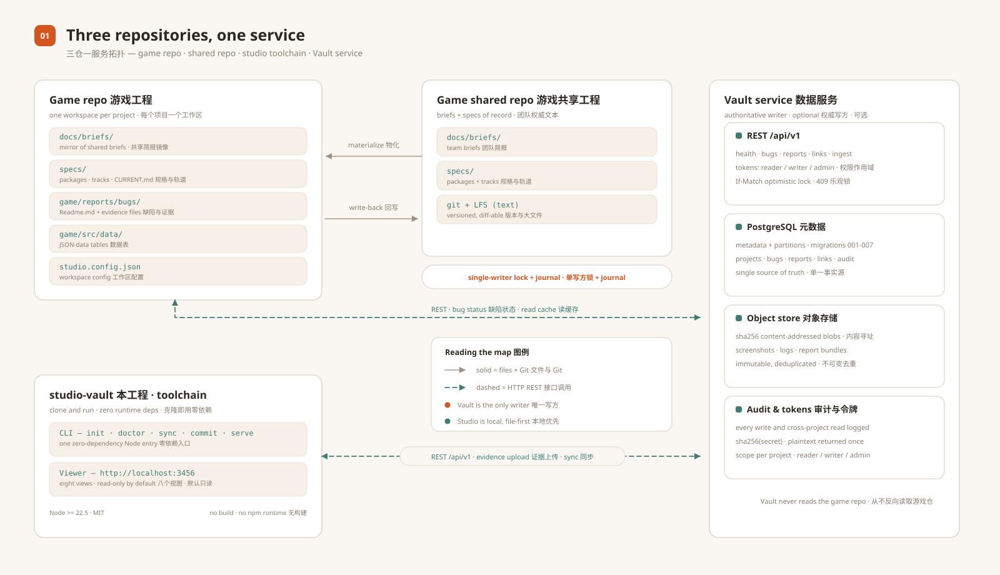
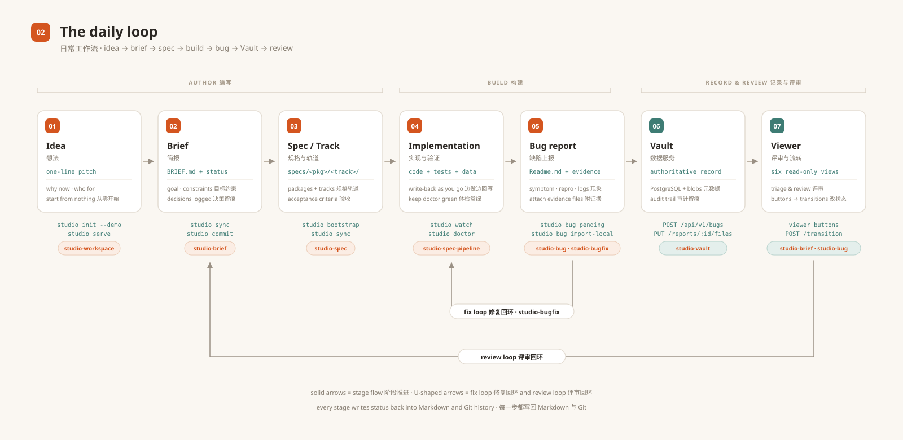
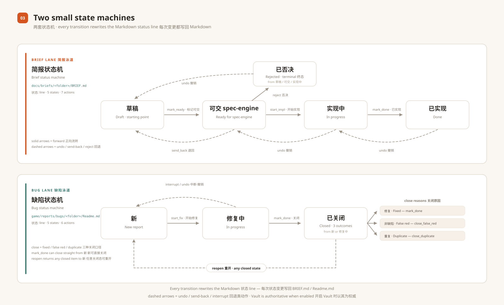
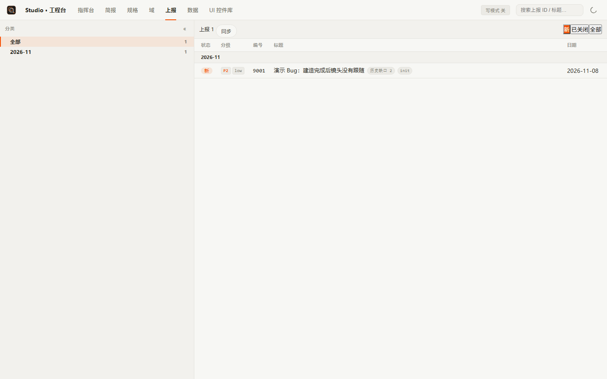
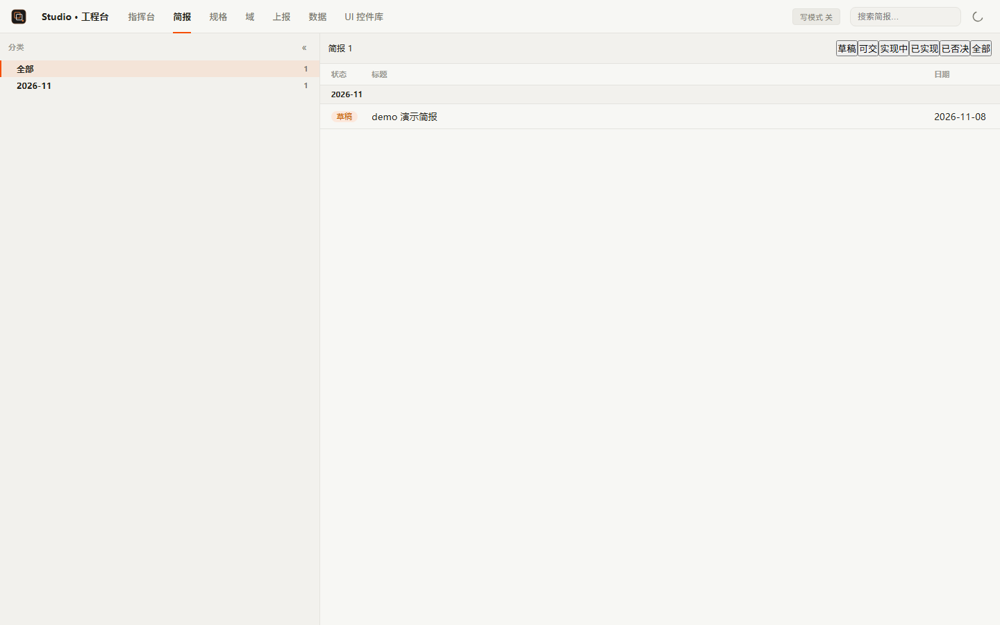
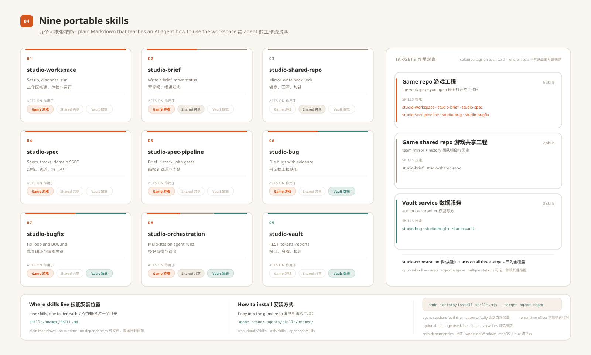

# Studio & Vault

**面向游戏团队的零依赖工作流与数据工具包。**

Studio 把游戏项目里每天都在产生的文件——简报（brief）、规格文档、Bug 上报包、数据表——
变成一套可以在本机浏览、在 Git 里评审的工作流。Vault 是配套的数据服务，负责存放体积大的
东西（截图、日志、上报包）：PostgreSQL 元数据、sha256 内容寻址对象存储，以及一套小巧的
REST API。

[English](README.md) · 中文 · MIT · 仅依赖 Node.js 标准库

---

## 一张图看懂：三个仓库 + 一个服务



| 方框 | 是什么 | 谁来搭 |
|---|---|---|
| **本工程 — studio-vault** | 工具链：`studio` CLI + 零依赖 viewer 服务。clone 下来直接跑，不用构建、不用装依赖。 | 一次 |
| **游戏工程（Game repo）** | 你的项目仓库。简报放 `docs/briefs/`，规格放 `specs/`，Bug 上报包放 `game/reports/bugs/`，数据表放 `game/src/data/`。 | 每个项目 |
| **游戏共享工程（Shared repo）** | 可选的团队级仓库，存放简报与规格。Studio 把它物化进游戏工程，并通过单写方锁 + journal 把改动写回。 | 每个团队 |
| **Vault 服务** | 可选的数据服务。Bug 工单与证据变成数据库行 + 内容寻址对象，通过 REST API 访问。 | 每个组织 |

三条让事情保持简单的规则：

1. **文件就是评审面。** 一份简报是带 `BRIEF.md` 的目录，一个 Bug 是带 `Readme.md`
   和证据文件的目录。每次状态变更都写回 Markdown，所以 `git log` 就是审计轨迹。
2. **启用 Vault 时，它是权威写方。** Bug 工单与上报包只有一个权威写方；游戏工程里的
   Markdown 是展示缓存，由 Studio 负责同步。
3. **一切都能优雅降级。** 没有共享仓？Studio 以单机模式工作。没有 Vault？viewer 仍然
   能基于文件工作。

---

## 日常闭环



| # | 阶段 | 发生什么 | 命令 | 配套 skill |
|---|---|---|---|---|
| 1 | **点子** | 建工作区或打开 viewer | `studio init --demo` · `studio serve` | `studio-workspace` |
| 2 | **简报** | 写 `BRIEF.md`，走评审状态 | `studio sync` · `studio commit` | `studio-brief` |
| 3 | **规格 / 轨** | 已确认的简报转成 specs 包与轨 | `studio bootstrap` · `studio sync` | `studio-spec` |
| 4 | **实现** | 开发，保持环境健康 | `studio watch` · `studio doctor` | `studio-spec-pipeline` |
| 5 | **Bug 上报** | 打包 Bug + 证据 | `studio bug pending` | `studio-bug` · `studio-bugfix` |
| 6 | **Vault** | 工单与证据写入权威存储 | `POST /api/v1/bugs` · `PUT /reports/:id/files` | `studio-vault` |
| 7 | **Viewer** | 在 viewer 里推动简报/Bug 状态 | viewer 按钮 · `POST /api/specviewer/transition` | `studio-brief` · `studio-bug` |

离开游戏工程的每条线，要么是 Git 镜像操作（共享仓），要么是 HTTP 调用（Vault）——
你的文件背后没有隐藏数据库。

---

## 两个小状态机



- **简报** —— 草稿 → 可交 spec-engine → 实现中 → 已实现；已否决 是旁支出口；
  `undo` 回退一步。
- **Bug** —— 新 → 修复中 → 已关闭（修复 / 非缺陷 / 重复 三个变体）；`reopen` 回到 新。

状态写在 Markdown 文件本身的 `状态:` 行里，可 diff、可合并、可回溯。

---

## 五分钟上手

### A. 十秒试跑 Vault（不需要 PostgreSQL）

```bash
cd vault
node scripts/vault-selftest.mjs --driver memory
# SUMMARY {"total":23,"pass":23,"fail":0}
```

用内存驱动起服务，跑真实 HTTP 契约：health/metrics、token scope 越权、乐观锁 409、
审计、ingest 幂等、备份/恢复演练。零配置、零数据库、零网络。

### B. 用演示工作区启动 Studio

```bash
# 在本仓库根目录
node packages/cli/bin/studio-cli.js init --demo
node packages/cli/bin/studio-cli.js serve
# 打开 http://localhost:3456
```

`init --demo` 会生成一份完整的本地工作区：`studio.config.json`、`specs/`、
带示例简报的 `docs/briefs/`、带示例 Bug 包的 `game/reports/bugs/`，以及一个小的
数据文件。打开 http://localhost:3456，对示例简报或 Bug 点一次状态流转——改动会直接
写回 Markdown 文件。

### C. 接到真实的游戏工程里

```bash
cd <你的游戏工程>
node <studio-vault 路径>/packages/cli/bin/studio-cli.js init

# 1. 编辑 studio.config.json：project id、共享仓（可选）、Vault URL（可选）
# 2. 体检
node <studio-vault 路径>/packages/cli/bin/studio-cli.js doctor
# 3. 起 viewer
node <studio-vault 路径>/packages/cli/bin/studio-cli.js serve
```

然后把已有简报挪到 `docs/briefs/<日期>-<主题>/BRIEF.md`，Bug 包挪到
`game/reports/bugs/<目录>/Readme.md`，下次刷新页面就会被扫描到。

> **完整接入指南：** [SETUP.zh-CN.md](SETUP.zh-CN.md) 覆盖「全新工程从零搭建」
> （共享仓 + 本机 Vault + viewer）与「现有工程最小改动接入」两条路径。[English](SETUP.md)

---

## Viewer 里能看到什么





八个视图，全部从工作区文件实时渲染：

| 视图 | 读取来源 | 用途 |
|---|---|---|
| **指挥台 Pulse** | specs + briefs + git 历史 | 仪表盘：活跃度、简报状态构成、KPI 趋势 |
| **简报 Briefs** | `docs/briefs/*/BRIEF.md` | 按状态评审简报 |
| **规格 Specs** | `specs/<package>/<track>/` | 浏览包、轨与任务清单 |
| **域 Domains** | `specs/**/CURRENT.md` | 按域维护的现行设计文档 |
| **上报 Bugs** | `game/reports/bugs/*/Readme.md` | 分诊 Bug、打开证据 |
| **性能 Performance** | 性能证据包 | 对比运行、趋势与集成记录 |
| **数据 Data** | `game/src/data/*.json` | 带 schema 浏览/编辑数据表 |
| **UI 控件库** | 你的 UI 注册表 | 控件清单与视觉索引 |

viewer 默认只监听 `127.0.0.1`。需要局域网访问时显式加 `--allow-lan`（只读浏览），
写路由始终只接受回环来源。

---

## 配套 Skills（已内置）



本仓库内置 9 个可移植的 skill，教 AI 编码代理如何在一个 Studio 工作区里干活——从搭工作区、写简报，到规格包、缺陷修复与 Vault API。
它们只是 Markdown（`SKILL.md`），没有运行时、没有依赖，任何从目录加载 skill 的
agent 都能用。

| Skill | 什么时候用 | 位置 |
|---|---|---|
| `studio-workspace` | 搭工作区、看 doctor 分级、起 viewer | `skills/studio-workspace/` |
| `studio-brief` | 写简报、推动简报生命周期 | `skills/studio-brief/` |
| `studio-shared-repo` | 与团队共享仓同步、处理写回冲突 | `skills/studio-shared-repo/` |
| `studio-spec` | 建规格包：轨文档、域 SSOT、viewer 读取契约 | `skills/studio-spec/` |
| `studio-spec-pipeline` | 跑完整 brief → PRD/TECH/TASK → 追溯/测试/评审流水线 | `skills/studio-spec-pipeline/` |
| `studio-bug` | 打包 Bug + 证据、走分诊状态 | `skills/studio-bug/` |
| `studio-bugfix` | 缺陷分诊、RED 测试 → 修复 → 回归 → 关闭 | `skills/studio-bugfix/` |
| `studio-orchestration` | 大改动用多站（builder / reviewer / coder / E2E）执行 | `skills/studio-orchestration/` |
| `studio-vault` | 用 Vault REST API、token、导入与备份 | `skills/studio-vault/` |

把它们装进你的游戏工程（复制即可，这只是文档不是代码）：

```bash
# 选你的 agent 读取 skill 的目录
cp -r skills/* <你的游戏工程>/.agents/skills/        # .claude/skills、.dsh/skills、.opencode/skills 同样支持
# 或使用零依赖安装脚本：
node scripts/install-skills.mjs --target <你的游戏工程> --dir .agents/skills
```

完整索引与触发词见 [skills/README.md](skills/README.md)。

---

## Studio 与 Vault 如何配合

- **Studio 是本地的、基于文件的。** 它读磁盘上的工作区、起 viewer、与团队共享仓
  同步简报，并把状态变更写回 Markdown。
- **Vault 是 Bug 工单与上报包的权威写方。** 它持有 PostgreSQL schema、对象存储、
  审计事件与 token。Studio 通过 REST 读 Vault，把游戏工程里的 `Readme.md` 当作
  展示缓存；启用 Vault 写通道后（`SPECVIEWER_VAULT_WRITE=1` + writer token 文件），
  viewer 里的状态变更先写 Vault，再写本地缓存。
- **Vault 从不读游戏工程。** 导入与切换是显式 CLI 操作（`vault-import.mjs`、
  `vault-reconcile.mjs`、`vault-dual-read.mjs`），单向数据流很好推理、也很好审计。

完整说明见 [docs/ARCHITECTURE.md](docs/ARCHITECTURE.md)。

---

## 环境要求

| 要求 | 说明 |
|---|---|
| Node.js `>= 22.5` | 我们在 Node 24 LTS 上开发和测试；22.5 是可选的 `studio kb` 索引使用 `node:sqlite` 的最低版本。 |
| Git | 共享仓工作流（`sync` / `commit` / `watch` / `bootstrap`）需要；`init`、`serve`、Vault 不需要。 |
| PostgreSQL 16+ | 可选——仅 Vault 生产部署（或自带 Compose 栈）。 |
| Docker + Compose | 可选——Vault 组合栈（PostgreSQL + MinIO + OpenSearch + API）。 |

## 命令参考

在本仓库根目录用 `node packages/cli/bin/studio-cli.js <command>` 运行；所有命令都支持
`--json`、`--cwd <dir>` 与 `--help`。

| 命令 | 作用 |
|---|---|
| `init` | 建工作区：`studio.config.json` + `specs/`、`docs/briefs/`、`game/reports/bugs/`、`game/src/data`；`--demo` 附带示例内容。 |
| `sync` | 从团队共享仓物化/校验 `docs/briefs` 镜像（禁 junction；未回写内容先 journal）。 |
| `commit` | 通过写事务锁把镜像改动写回共享仓（单写方 + push 重试）。 |
| `watch` | 监听镜像并自动回写。 |
| `status` | 一次性只读状态：配置路径、共享仓、镜像差异、待回写、journal、hooks 路径。 |
| `doctor` | shared / mirror / LFS / budget / kb / vault 分级体检；`degraded` 不是失败，`fail` 才是。 |
| `bootstrap` | 一键检出：clone 共享仓、拉取文本类 LFS、物化 `docs/briefs`、装 hooks、校验。 |
| `mirror-switch` | 计划中的镜像策略切换（默认 dry-run，`--execute` 才执行）。 |
| `workspace` | 本机工作区注册表（`~/.studio/workspace.json`，不入库；token 只存 credential 引用）。 |
| `project` | 本机项目注册与探测（cwd -> git 顶层 -> project）。 |
| `serve` | 启动本地 Studio viewer（默认 http://127.0.0.1:3456）。 |
| `bug` | 上报链：`pending` / `status`（离线队列）、`import-local`（回填 Vault）、`check`（自检）。 |
| `kb` | 共享文本知识库索引（`rebuild` / `status` / `search`）；需要 Node 内置 SQLite。 |

## 目录结构

```
.
+-- packages/
|   +-- shared/   @studio/shared  零依赖原语（config schema / JSON IO / git / LFS / doctor 分级）
|   +-- studio/   @studio/local   命令实现 + viewer 服务（src/serve/）
|   +-- cli/      @studio/cli     CLI 入口（bin/studio-cli.js -> @studio/local）
+-- skills/                      内置配套 skills（纯 Markdown）
+-- vault/                       Vault 数据服务（零运行时依赖）
|   +-- src/                     HTTP API、鉴权、store（memory / PostgreSQL）、对象存储
|   +-- migrations/              追加式 SQL 迁移
|   +-- scripts/                 migrate / token / backup / restore-check / retention / import / reconcile
|   +-- test/                    node:test 测试
|   +-- deploy/                  Compose 栈、Windows 示例脚本、systemd 单元
+-- docs/                        架构、快速开始、素材（图 + 截图）
+-- scripts/                     发布自检 + skill 安装脚本
```

## 文档

- [SETUP.zh-CN.md](SETUP.zh-CN.md) —— 接入指南：全新工程从零搭建，或现有工程最小改动接入
  （共享仓 + 本机 Vault）。[English](SETUP.md)
- [docs/QUICKSTART.md](docs/QUICKSTART.md) —— 三条路径：Vault 内存模式、Studio 演示
  工作区、PostgreSQL + Compose。
- [docs/ARCHITECTURE.md](docs/ARCHITECTURE.md) —— Studio 分层、viewer 数据流、Vault
  内部结构与两者如何连接。
- [skills/README.md](skills/README.md) —— 配套 skills 索引与安装方式。
- [vault/README.md](vault/README.md) —— Vault 快速开始、API 表与部署矩阵。
- [vault/docs/DATABASE.md](vault/docs/DATABASE.md) —— schema、分区、保留、备份与对象
  存储设计。
- [vault/docs/API-DIRECT-REPORT.md](vault/docs/API-DIRECT-REPORT.md) —— 直报与证据
  上传契约。
- [CONTRIBUTING.md](CONTRIBUTING.md) —— 开发环境、零依赖红线、测试与 PR 流程。
- [CHANGELOG.md](CHANGELOG.md) —— 版本历史。

## 项目状态

Pre-1.0。`@studio/*` 包与 Vault 服务都还在 1.0 之前：次版本之间接口仍可能变化；
Vault 的 `/api/v1` 保持加法兼容。仓库以 MIT 协议开源、以源码为先：clone 下来就能跑。

## 贡献

欢迎贡献。请先读 [CONTRIBUTING.md](CONTRIBUTING.md) —— 简短版：运行时依赖保持零、
跑测试、Conventional Commits、凭据不入库。

## 许可证

[MIT](LICENSE)。