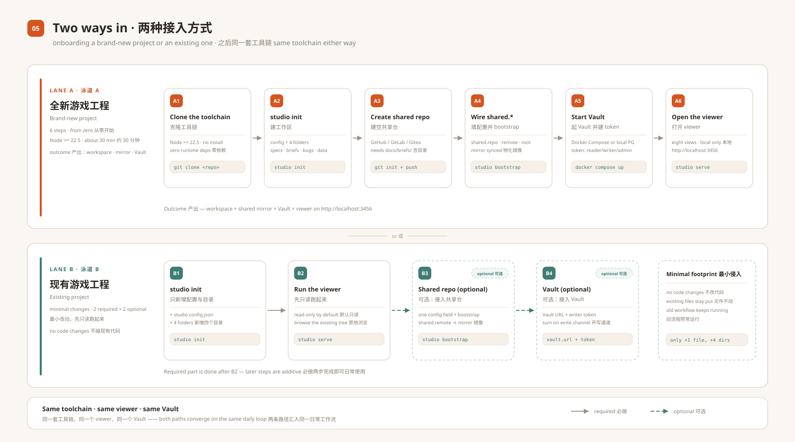

# SETUP — bring Studio into a game project

This guide sets up a **complete, working Studio workspace**: a game repository, an
optional team shared repository, a local Vault service and the browser viewer.
It has two paths — pick the one that matches you:

- **Path A — brand-new project.** Start from zero and get the full setup.
- **Path B — existing project.** Adopt the tool in an existing game repository
  with the smallest possible footprint (one config file and four directories; no
  code changes).



The commands below were exercised on Windows with Node.js 24 and Git 2.55. The
Docker and PostgreSQL options follow the bundled Compose/environment files; if
your machine has neither, use the no-Docker memory path in A5.

Commands use two shorthands:

| Shorthand | Meaning |
|---|---|
| `<studio>` | the path to this repository (the toolchain checkout), e.g. `D:/tools/studio-vault` |
| `<game>` | the path to your game repository, e.g. `D:/work/my-game` |

If you prefer not to type the full path every time, define an alias:

```bash
# bash / zsh
alias studio="node /path/to/studio-vault/packages/cli/bin/studio-cli.js"
# PowerShell (current session)
function studio { node D:/tools/studio-vault/packages/cli/bin/studio-cli.js @args }
```

### Shell notes (Windows PowerShell)

Most code blocks below are bash. On Windows these are the equivalents:

| bash | PowerShell |
|---|---|
| `mkdir -p docs/briefs` | `New-Item -ItemType Directory -Force docs/briefs` |
| `printf '# x\n' > f` | `Set-Content -Path f -Value '# x' -Encoding utf8` |
| `cp a b` | `Copy-Item a b` |
| `export VAR=value` | `$env:VAR = "value"` |
| `cat f` | `Get-Content f` |

---

## 0. What you are creating

| Piece | What it is | Needed for |
|---|---|---|
| **Game repo** `<game>` | Your project repository. The workspace lives here: `studio.config.json`, `docs/briefs/`, `specs/`, `game/reports/bugs/`, `game/src/data/`. | always |
| **Shared repo** | Optional team-level Git repository holding briefs (and, by convention, specs). Studio mirrors its `docs/briefs/` into the game repo and writes changes back through a single-writer lock. | teams; optional for solo work |
| **Vault service** | Optional data service for bug tickets and evidence: PostgreSQL metadata + content-addressed object storage + REST API. | teams that need a queryable archive; optional |
| **Viewer** | The browser UI served by `studio serve` at `http://localhost:3456`, reading the game repo files. | always |

**Minimal footprint of the whole toolchain:** one file `studio.config.json` plus
four directories in your game repo. Everything else is optional and can be added
later.

---

## 1. Prerequisites

| Requirement | Check | Notes |
|---|---|---|
| Node.js **>= 22.5** | `node --version` | What the packages declare. Node 24 LTS is what we develop and test on. Only `studio kb` actually needs 22.5+ (`node:sqlite`); a direct clone of the CLI/viewer runs on Node 20 as well, without `kb`. |
| Git | `git --version` | Required for the shared-repo workflows; not for `init`/`serve`. |
| git-lfs **>= 3.4** | `git lfs version` | Optional but recommended when the shared repo stores text LFS pointers; `bootstrap` reports a degraded step without it. |
| Docker + Compose | `docker compose version` | Only for the durable Vault stack. |
| PostgreSQL 16+ | `psql --version` | Only if you run Vault without Docker. |
| Free ports | — | Viewer `3456`; Vault `3460`. |

Get the toolchain once, anywhere on the machine (it is not the game repo):

```bash
git clone https://github.com/<owner>/studio-vault.git D:/tools/studio-vault
node D:/tools/studio-vault/packages/cli/bin/studio-cli.js --version
# studio <version>   (for example 0.1.17)
```

There is no build step and no `npm install` required for the CLI or the viewer.

---

## 2. Path A — brand-new project from zero

### A1. Create the game repo

```bash
mkdir <game> && cd <game>
git init -b main
```

### A2. Create the workspace (and make the first commit)

```bash
node <studio>/packages/cli/bin/studio-cli.js init
git add -A
git commit -m "studio workspace"
```

`init` writes **only** these paths into the current directory:

```text
studio.config.json          workspace config (no secrets)
specs/                      spec packages + tracks (viewer: Specs / Domains)
docs/briefs/                briefs (viewer: Briefs; mirrored from the shared repo)
game/reports/bugs/          bug packages (viewer: Bugs)
game/src/data/              JSON data tables (viewer: Data)
```

Do the first commit right away: the Pulse dashboard reads Git history, and a
repository with no commits makes the viewer log "your current branch does not
have any commits yet". Empty directories are not tracked by Git; `init` and
`serve` recreate them, so you do not need to force them into the commit (add a
`.gitkeep` only if you want them in the tree explicitly).

The generated config already has safe defaults:

```json
{
  "version": 1,
  "project": { "id": "my-game", "name": "my-game", "gameRepo": "." },
  "shared":  { "repo": "my-game-shared", "branch": "main", "mirror": "docs/briefs", "lfs": "text" },
  "vault":   { "url": "http://127.0.0.1:3460", "project": "my-game" },
  "studio":  { "port": 3456, "worktreePortBase": 3457 },
  "kb":      { "namespace": "my-game" }
}
```

`init` is idempotent: existing files are kept. To preview the whole thing with
sample content first, run `init --demo` in a scratch folder instead.

### A3. Create the shared repository

Create an **empty Git repository** on your Git host (GitHub / GitLab / Gitea /
any bare repo), for example `my-game-shared`. Then give it an initial commit that
contains the briefs directory — Studio requires `docs/briefs/` to exist on the
shared repo's branch:

```bash
mkdir -p /tmp/seed-shared && cd /tmp/seed-shared
git clone <shared-repo-url> .
mkdir -p docs/briefs
printf '# Team briefs\n' > docs/briefs/README.md
git add -A && git commit -m "init shared briefs"

# the branch name must match shared.branch in studio.config.json (default: main)
git branch -M main
git push -u origin main
```

If your Git host created the repo with a different default branch (for example
`master`), either rename it as above or set `shared.branch` in
`studio.config.json` to the branch you actually use.

Keep the shared repo **private** if your briefs are internal.

### A4. Point the workspace at the shared repo and bootstrap

Merge these settings into `<game>/studio.config.json` — keep the existing
`version`/`project`/`vault`/`kb` keys and only add/update the `shared` object:

```json
{
  "shared": {
    "repo": "my-game-shared",
    "branch": "main",
    "remote": "https://example.com/you/my-game-shared.git",
    "root": "${WORKSPACE_ROOT}/my-game-shared",
    "mirror": "docs/briefs",
    "lfs": "text"
  }
}
```

`WORKSPACE_ROOT` expands to the parent directory of the game repo. Then run:

```bash
cd <game>
node <studio>/packages/cli/bin/studio-cli.js bootstrap
node <studio>/packages/cli/bin/studio-cli.js doctor --json
```

`bootstrap` does four things, all idempotent:

1. clones `shared.remote` into `shared.root`;
2. pulls text LFS pointers (when git-lfs is installed);
3. materialises `shared.root/docs/briefs` into `<game>/docs/briefs` (real files, no junctions);
4. copies your Git identity into the shared clone and sets `core.hooksPath=.githooks`.

`doctor` should now report `shared`, `mirror`, `lfs` and `budget` as `ok`.
Vault and `kb` may stay `degraded` until you finish A5.

> If `bootstrap` says `ok=false`, re-run it with `--json` to see the failed step.
> The most common cause is a branch mismatch — the message is
> `Remote branch <name> not found in upstream origin`.

**Daily shared-repo loop**

```bash
# teammates' briefs -> your workspace
node <studio>/packages/cli/bin/studio-cli.js sync

# your brief edits -> shared repo (single-writer lock + journal + push retry)
node <studio>/packages/cli/bin/studio-cli.js commit --message "brief: add farm rework"

# or continuously
node <studio>/packages/cli/bin/studio-cli.js watch
```

Rules of thumb:

- Write a new brief as `<game>/docs/briefs/<yyyy-mm-dd>-<topic>/BRIEF.md`.
- If `sync` refuses with `mirror_has_unwritten`, run `commit` first (or
  `sync --force` to journal and discard local edits — it will not silently lose them).
- `commit` pushes to the shared repo. Committing the same files into your **game**
  repo is a normal `git` operation you do as usual.
- `commit` takes `--message "<text>"` (it does not accept the short `-m`).

### A5. Start a local Vault service

Pick the option that fits your machine.

**Option 1 — Docker Compose (recommended; durable).**

```bash
cd <studio>/vault/deploy
cp .env.example .env      # set VAULT_PG_PASSWORD and VAULT_MINIO_PASSWORD
docker compose up -d --build
curl -s http://127.0.0.1:3460/api/v1/health
```

This starts PostgreSQL (metadata), MinIO (object storage), OpenSearch
(rebuildable index) and the Vault API. Migrations are applied on startup.
The `.env` lives inside the toolchain checkout (it is gitignored); never commit it.

**Option 2 — local PostgreSQL, no Docker.**

```bash
cd <studio>/vault
export VAULT_DB=pg VAULT_PG_HOST=127.0.0.1 VAULT_PG_PORT=5432
export VAULT_PG_USER=vault VAULT_PG_PASSWORD=<password> VAULT_PG_DB=vault
node scripts/vault-migrate.mjs --create-database   # creates the database + migrations
node src/server.mjs
```

**Option 3 — memory mode (no Docker, no PostgreSQL; data is lost on exit).**

```bash
cd <studio>/vault
node src/server.mjs            # memory is the default driver; http://127.0.0.1:3460
# wrappers (same thing): powershell -NoProfile -ExecutionPolicy Bypass -File scripts\start-dev.ps1
#                        ./scripts/start-dev.sh
```

Memory mode seeds two demo projects and three fixed dev tokens. It is the right
choice for trying the workflow and for CI-like checks; it is not durable storage.

| Demo project | Fixed dev token |
|---|---|
| `demo-project` | `vt_devtokena_dev-secret-a` (admin) |
| `demo-b` | `vt_devtokenb_dev-secret-b` (writer) |
| both | `vt_devtokenm_dev-secret-m` (admin) |

Stop any option with `Ctrl+C` (Compose: `docker compose down`).

### A6. Create a token and wire Studio to Vault

**Durable store (option 1 or 2)** — create a project-scoped token:

```bash
cd <studio>/vault
node scripts/vault-token.mjs create --label dev-laptop --project my-game --role admin --ensure-project
# prints the raw token ONCE (e.g. vt_xxxxxxxx_yyyyyyyy); Vault only stores its sha256
```

**Memory store (option 3)** — token creation in a separate process does **not**
affect the running in-memory server. Use one of the seeded dev tokens instead
and point `vault.project` at a seeded demo project:

```json
{ "vault": { "url": "http://127.0.0.1:3460", "project": "demo-project" } }
```

Store the token **outside any repository** — create the directory first:

```bash
mkdir -p ~/.studio/secrets
printf '%s\n' '<token>' > ~/.studio/secrets/vault-writer-token.txt
# PowerShell:
# New-Item -ItemType Directory -Force $HOME\.studio\secrets
# Set-Content -Path $HOME\.studio\secrets\vault-writer-token.txt -Value '<token>' -Encoding ascii
```

Studio reads `~/.studio/secrets/vault-writer-token.txt` by default;
`STUDIO_VAULT_WRITER_TOKEN_FILE` overrides it.

`studio doctor` checks Vault **health only** — it reports `vault: ok` even when the
token is missing or invalid. A bad token surfaces on the first write
(`vault_write_failed` / `unauthorized`), not in `doctor`.

**Optional: make Vault the authoritative writer for bug status.** By default the
viewer only edits local Markdown. Start the viewer with the write channel
enabled so a status transition writes Vault first and the local `Readme.md`
second:

```bash
# PowerShell
$env:SPECVIEWER_VAULT_WRITE = "1"
$env:STUDIO_VAULT_WRITER_TOKEN_FILE = "$HOME/.studio/secrets/vault-writer-token.txt"
node <studio>/packages/cli/bin/studio-cli.js serve

# bash
SPECVIEWER_VAULT_WRITE=1 \
STUDIO_VAULT_WRITER_TOKEN_FILE=~/.studio/secrets/vault-writer-token.txt \
node <studio>/packages/cli/bin/studio-cli.js serve
```

Leave it unset and the viewer works purely from files — nothing breaks.

**Two data directions, both explicit:**

| Direction | How |
|---|---|
| Local bug packages → Vault | `studio bug import-local --source <game>` (backfill, idempotent) |
| Vault → local bug snapshot | viewer's sync button (`POST /api/sync`) or `node <studio>/packages/studio/src/serve/vault-sync.js` with `STUDIO_ROOT`, `VAULT_URL`, `VAULT_TOKEN_FILE` (read token, default `~/.studio/secrets/vault-token.txt`) |

> No Docker and no PostgreSQL? Use option 3 plus the seeded `demo-project` /
> `vt_devtokena_dev-secret-a` pair above — the whole write path (import-local,
> status transitions, `/api/sync`) works end to end. Just remember the data is
> gone when the process exits.

### A7. Open the viewer

```bash
cd <game>
node <studio>/packages/cli/bin/studio-cli.js serve
# Studio viewer at http://localhost:3456
```

Useful flags: `--port 3461`, `--bind 0.0.0.0 --allow-lan` (read-only browsing
from other machines; write routes stay loopback-only), `--readonly`.

### A8. Verify the installation

| Check | Command | Expected |
|---|---|---|
| CLI works | `node <studio>/packages/cli/bin/studio-cli.js --version` | `studio <version>` (e.g. `0.1.17`) |
| Workspace healthy | `studio doctor --json` | `ok` or `degraded`; `fail` only for broken config |
| Shared repo wired | `studio status` | `shared.ok=true`, mirror counts match |
| Brief round-trip | create a brief, then `studio commit --message "..."` | shared repo gets the new commit |
| Viewer | open `http://localhost:3456` | the tabs render with content, no stuck "loading" |
| Status write | click a status button on a brief/bug | the `状态:` line in the Markdown file changes |
| Status write (scripted) | `curl -X POST http://127.0.0.1:3456/api/specviewer/transition -H "Content-Type: application/json" -d '{"kind":"bug","id":"<folder>","action":"start_fix"}'` | `{"ok":true,...}`; the Readme changes |
| Vault | `curl -s http://127.0.0.1:3460/api/v1/health` | `"status":"ok"` (memory mode: `degraded`, expected) |

The viewer currently has eight tabs: **Pulse 指挥台**, **Briefs 简报**,
**Specs 规格**, **Domains 域**, **Bugs 上报**, **Performance 性能**,
**Data 数据** and **UI kit 控件库**.

---

## 3. Path B — adopt in an existing game repository (minimal changes)

The tool is **additive and non-invasive**: it never rewrites your code. You add
one config file and four directories, and you can delete them to roll back.

### B1. Add the workspace

```bash
cd <game>                                    # repo root (git top level)
node <studio>/packages/cli/bin/studio-cli.js init
```

Existing files are kept; `init` only creates what is missing. Result:
`+1 file` (`studio.config.json`) and `+4 directories` (the directories are
recreated by `init`/`serve` if they are not tracked by Git, so an empty
`git status` listing only the config is normal).

If your repository has an unusual root or you want to keep the config elsewhere,
keep it at the Git top level anyway — Studio discovers the workspace by walking
up to the enclosing Git repository (or the nearest directory containing
`studio.config.json` + `specs/`).

### B2. Do a read-only pilot first

```bash
node <studio>/packages/cli/bin/studio-cli.js serve
```

The viewer simply reads what exists:

- `docs/briefs/` empty → Briefs view empty (create a brief when ready, see §4).
- `specs/` empty → Specs/Domains empty; you can add spec packages later (see `skills/studio-spec`).
- `game/reports/bugs/` empty → Bugs empty. **Your existing bug tracker can stay**;
  Studio only reads bug packages that live in that directory.
- `game/src/data/` empty → Data empty.

No write happens until you press a status button or edit a data table.

### B3. Optional — connect the team shared repository

Same as A3/A4: create/choose the shared repo, set `shared.remote` in
`studio.config.json`, run `studio bootstrap`, then `sync` / `commit`.

One caution when adopting an existing project: `sync` materialises the shared
repo's briefs into `docs/briefs`. If you already have local briefs there that the
shared repo does not know yet, `sync` refuses with `mirror_has_unwritten` —
`commit` them first so nothing is overwritten.

### B4. Optional — connect Vault

Same as A5/A6. Vault runs as its own service; nothing in your game repo changes.
Turn the write channel on only after the read path (`doctor` shows `vault: ok`)
is stable.

### B5. Where your existing artefacts go

| Existing artefact | Destination | Notes |
|---|---|---|
| Design/brief documents | `docs/briefs/<yyyy-mm-dd>-<topic>/BRIEF.md` | One folder per brief. You can keep attachments next to it. |
| Feature specs / RFCs | `specs/<package>/<track>/…` | See `skills/studio-spec` for the document contract the viewer counts (8 track docs). Optional. |
| Live design docs per domain | `specs/<package>/domains/<domain>/CURRENT.md` (+ `TESTS.md`, `VISUAL.md`) + `domains/_index.yml` | Optional; powers the Domains view. |
| Bug reports / tickets | `game/reports/bugs/<folder>/Readme.md` (+ evidence files) | Field format in §4. Your existing tracker can coexist; migrate only what you want visible in the viewer. |
| Data tables | `game/src/data/*.json` (+ optional `*.schema.json`) | Optional; the Data view edits whitelisted fields. |

### B6. Rollback

Delete `studio.config.json` and the four generated directories (plus the shared
clone, e.g. `../my-game-shared`). Nothing else was touched. Keep the toolchain
checkout if you like — it is a separate clone.

---

## 4. File formats

### 4.1 `studio.config.json` (minimal)

```json
{
  "version": 1,
  "project": { "id": "my-game", "name": "My Game", "gameRepo": "." },
  "shared":  { "repo": "my-game-shared", "branch": "main", "mirror": "docs/briefs", "lfs": "text" },
  "vault":   { "url": "http://127.0.0.1:3460", "project": "my-game" },
  "studio":  { "port": 3456 },
  "kb":      { "namespace": "my-game" }
}
```

Add `shared.remote` (and optionally `shared.root`) when you connect a shared
repo. Never put tokens in this file.

### 4.2 Brief — `docs/briefs/<date>-<topic>/BRIEF.md`

```markdown
# 简报：<title>

日期: 2026-11-08
包提示: my-game
域: farm, construction
状态: **草稿**

## 1. 问题
...

## 2. 目标
1. ...

## 3. 非目标
...

## 4. 验收标准
- AC-1 ...
```

The status line is **Chinese-labelled** (`状态:`); that is the line the viewer
reads and rewrites. Do not use an English `Status:` line — the list may still
display a status via a permissive parser, but a transition would append a second
line instead of rewriting it.

Statuses: `草稿` (draft) → `可交 spec-engine` (ready) → `实现中` (in progress) →
`已实现` (done), plus `已否决` (rejected). Transitions happen through the viewer
buttons or `POST /api/specviewer/transition` with
`{"kind":"brief","id":"<folder>","action":"mark_ready"}`.

### 4.3 Bug package — `game/reports/bugs/<folder>/Readme.md`

```markdown
# <title>

ID: 87654321
标题: <title>
描述: What happened, expected vs actual.
复现时间: 2026-11-08 14:30
状态: 新
优先级: P2
严重度: 一般
构建: {"version":"0.1.0"}
环境: {"os":"Windows 11","gpu":"..."}
复现步骤: [{"step":"launch"},{"step":"click Start"}]
日志: game/logs/run.log
截图: shots/crash.png
历史变更:
- [2026-11-08] created
```

Field labels are Chinese by convention (`ID`, `标题`, `描述`, `复现时间`, `状态`,
`优先级`, `严重度`, `构建`, `环境`, `复现步骤`, `日志`, `截图`, `历史变更`); the viewer
and the Vault bridge parse these lines. Status vocabulary: `新` → `修复中` →
`已关闭` (with `已关闭 · 非缺陷` / `已关闭 · 重复` variants); `reopen` returns to `新`.
The 8-digit `ID` is the legacy id used to match the same ticket in Vault.

### 4.4 Secrets

| File | Purpose |
|---|---|
| `~/.studio/secrets/vault-writer-token.txt` | writer token for Vault-first status writes (viewer) |
| `~/.studio/secrets/vault-token.txt` | read token for Vault → local bug snapshot sync |
| `<studio>/vault/deploy/.env` | PostgreSQL / MinIO passwords (gitignored) |

Never commit tokens or `.env`.

---

## 5. Troubleshooting

| Symptom | Cause / fix |
|---|---|
| `not_a_studio_repo` | Run inside the workspace root (config + `specs/`), or pass `--cwd <dir>`. |
| `doctor` says `shared`/`mirror` `degraded` with `single_machine` | No `shared.remote` and no shared checkout — expected for a solo workspace. |
| `bootstrap` reports `no remote in studio.config.json` | Fill `shared.remote` first. |
| `bootstrap` fails to clone / `Remote branch ... not found` | The branch must match `shared.branch`; rename the shared branch (`git branch -M main`) or change the config. Re-run with `--json` to see the failed step. |
| `sync` → `mirror_has_unwritten` | Commit local brief edits first (`studio commit`), or `sync --force` to journal them. |
| `commit` → `git_identity_missing` | Set `git config user.name/user.email` (bootstrap copies them into the shared clone). |
| `commit` → push rejected | Someone else pushed first: resolve (`git -C <shared.root> pull --rebase`) and re-run `commit`; the local commit is kept. |
| `commit -m ...` → unknown argument | `commit` uses `--message "<text>"`. |
| Viewer logs `your current branch 'main' does not have any commits yet` | Make a first commit in the game repo (`git add -A && git commit -m "studio workspace"`). |
| Viewer port in use | `studio serve --port 3461`. |
| `doctor` Vault `degraded` | Vault not running — not a failure. |
| `doctor` Vault `ok` but writes fail with `unauthorized` | `doctor` only probes health; the token is missing/invalid. Write the token file (A6) and restart the viewer. |
| Vault transition → `409 version_conflict` | Another writer changed the bug first; retry (client refreshes once). |
| `studio bug import-local` fails | The human output now prints the cause (missing token / unreachable Vault) and the token file path. Re-run with `--json` for the full detail. |
| `studio bug check` fails in a fresh workspace | It checks the optional in-game F3 reporter integration (`game/src/systems/vault_reporter.gd` etc.). A new workspace does not have it; this check is only meaningful once you install that integration. |
| `kb` → `node_sqlite_unavailable` | Node < 22.5; upgrade Node. Nothing else depends on SQLite. |
| Memory-mode token rejected (`unauthorized`) | `vault-token.mjs create` does not affect a running memory server; use the seeded dev tokens in A5 and set `vault.project` to `demo-project`. |

---

## 6. Day-2 operations (cheat sheet)

```bash
# shared briefs
studio sync && studio status             # pull teammates' changes, inspect
studio commit --message "brief: ..."     # write back + push (single writer)
studio watch                             # keep writing back automatically

# viewer
studio serve                             # http://localhost:3456 (loopback only)

# health
studio doctor --json                     # ok | degraded | fail

# Vault
curl -s http://127.0.0.1:3460/api/v1/health
node <studio>/vault/scripts/vault-backup.mjs
node <studio>/vault/scripts/vault-status.mjs
docker compose -f <studio>/vault/deploy/docker-compose.yml down   # if you used Compose
```

Companion skills (bundled in this repository) teach an AI coding agent each of
these workflows: `skills/studio-workspace`, `skills/studio-brief`,
`skills/studio-shared-repo`, `skills/studio-spec`, `skills/studio-spec-pipeline`,
`skills/studio-bug`, `skills/studio-bugfix`, `skills/studio-orchestration`,
`skills/studio-vault`. Install them into your game repo with
`node <studio>/scripts/install-skills.mjs --target <game>`.
