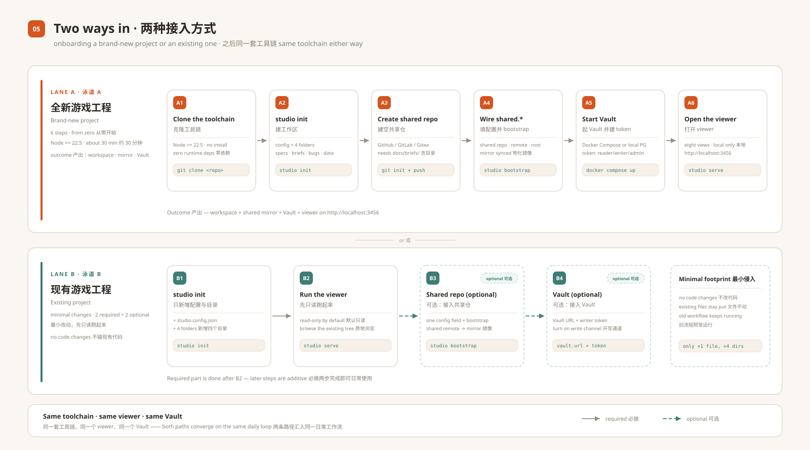

# SETUP —— 把 Studio 接进一个游戏工程

这份文档带你搭出一套**完整可用的 Studio 工作区**：游戏工程、可选的团队共享工程、
本机 Vault 服务，以及浏览器 viewer。两条路径，按需选一条：

- **路径 A —— 全新工程**：从零开始，完整搭建。
- **路径 B —— 现有工程**：以最小侵入接入（只加 1 个配置文件 + 4 个目录，不改任何代码）。



以下命令在 Windows + Node.js 24 + Git 2.55 上实测过；Docker 与 PostgreSQL 两条路径遵循仓库
自带的 Compose / env 文件，如果机器上两者都没有，用 A5 的无 Docker 内存模式。

两个简写：

| 简写 | 含义 |
|---|---|
| `<studio>` | 本仓库（工具链 checkout）的路径，如 `D:/tools/studio-vault` |
| `<game>` | 你的游戏工程路径，如 `D:/work/my-game` |

不想每次敲全路径就设个别名：

```bash
# bash / zsh
alias studio="node /path/to/studio-vault/packages/cli/bin/studio-cli.js"
# PowerShell（当前会话）
function studio { node D:/tools/studio-vault/packages/cli/bin/studio-cli.js @args }
```

### Windows PowerShell 命令对照

下文代码块多为 bash；Windows 等价写法：

| bash | PowerShell |
|---|---|
| `mkdir -p docs/briefs` | `New-Item -ItemType Directory -Force docs/briefs` |
| `printf '# x\n' > f` | `Set-Content -Path f -Value '# x' -Encoding utf8` |
| `cp a b` | `Copy-Item a b` |
| `export VAR=value` | `$env:VAR = "value"` |
| `cat f` | `Get-Content f` |

---

## 0. 你要搭的是哪些东西

| 部件 | 是什么 | 什么时候需要 |
|---|---|---|
| **游戏工程** `<game>` | 你的项目仓库。工作区就在里面：`studio.config.json`、`docs/briefs/`、`specs/`、`game/reports/bugs/`、`game/src/data/`。 | 始终 |
| **共享工程** | 可选的团队级 Git 仓库，存简报（按惯例也存规格）。Studio 把它的 `docs/briefs/` 镜像到游戏工程，并通过单写方锁把改动写回。 | 团队；单人可不用 |
| **Vault 服务** | 可选的数据服务：Bug 工单与证据的 PostgreSQL 元数据 + 内容寻址对象存储 + REST API。 | 需要可查询归档的团队；可选 |
| **Viewer** | `studio serve` 起的浏览器界面，默认 `http://localhost:3456`，直接读游戏工程里的文件。 | 始终 |

**整套工具链的最小侵入面**：游戏工程里只多一个 `studio.config.json` 和四个目录，
其余全部可选、可后补。

---

## 1. 环境要求

| 要求 | 检查 | 说明 |
|---|---|---|
| Node.js **>= 22.5** | `node --version` | 各包声明的版本；我们在 Node 24 LTS 上开发和测试。实际只有 `studio kb` 需要 22.5+（`node:sqlite`）；直接 clone 的 CLI/viewer 在 Node 20 上也能跑，只是没有 `kb`。 |
| Git | `git --version` | 共享工程工作流需要；`init`/`serve` 不需要。 |
| git-lfs **>= 3.4** | `git lfs version` | 可选但推荐（共享仓存文本 LFS 指针时用）；没有时 `bootstrap` 的 lfs 步骤会 degraded。 |
| Docker + Compose | `docker compose version` | 只用于持久化 Vault 组合栈。 |
| PostgreSQL 16+ | `psql --version` | 只在不用 Docker、直接跑 Vault 时需要。 |
| 空闲端口 | — | viewer `3456`；Vault `3460`。 |

先拿工具链（放在机器任意位置，**不是**游戏工程）：

```bash
git clone https://github.com/<owner>/studio-vault.git D:/tools/studio-vault
node D:/tools/studio-vault/packages/cli/bin/studio-cli.js --version
# studio <版本号>（例如 0.1.17）
```

CLI 与 viewer 不需要构建、也不需要 `npm install`。

---

## 2. 路径 A —— 从零开始的新工程

### A1. 建游戏工程

```bash
mkdir <game> && cd <game>
git init -b main
```

### A2. 建工作区，并做首次提交

```bash
node <studio>/packages/cli/bin/studio-cli.js init
git add -A
git commit -m "studio workspace"
```

`init` 只会在当前目录写入：

```text
studio.config.json          工作区配置（不含任何密钥）
specs/                      规格包与轨（viewer：规格 / 域）
docs/briefs/                简报（viewer：简报；由共享工程镜像而来）
game/reports/bugs/          Bug 上报包（viewer：上报）
game/src/data/              JSON 数据表（viewer：数据）
```

**建完立刻做首次提交**：Pulse 仪表盘依赖 Git 历史；仓库没有任何提交时 viewer 终端会反复出现
"your current branch does not have any commits yet"。空目录不会被 Git 跟踪，`init`/`serve`
会自动重建，所以不必强塞进提交（想显式保留可加 `.gitkeep`）。

生成的配置默认值安全：

```json
{
  "version": 1,
  "project": { "id": "my-game", "name": "my-game", "gameRepo": "." },
  "shared":  { "repo": "my-game-shared", "branch": "main", "mirror": "docs/briefs", "lfs": "text" },
  "vault":   { "url": "http://127.0.0.1:3460", "project": "my-game" },
  "studio":  { "port": 3456, "worktreePortBase": 3457 },
  "kb":      { "namespace": "my-game" }
}
```

`init` 是幂等的：已存在的文件保持不动。想先看带示例内容的效果，可在临时目录里用
`init --demo`。

### A3. 建共享工程

在你的 Git 托管（GitHub / GitLab / Gitea / 任意裸仓）上新建**空仓库**，例如
`my-game-shared`。然后给它一个包含 `docs/briefs/` 目录的初始提交——Studio 要求共享仓
当前分支上存在 `docs/briefs/`：

```bash
mkdir -p /tmp/seed-shared && cd /tmp/seed-shared
git clone <共享仓地址> .
mkdir -p docs/briefs
printf '# Team briefs\n' > docs/briefs/README.md
git add -A && git commit -m "init shared briefs"

# 分支名必须与 studio.config.json 的 shared.branch 一致（默认 main）
git branch -M main
git push -u origin main
```

如果你的 Git 托管建出来的默认分支不是 `main`（例如 `master`），要么像上面那样改名，
要么把 `studio.config.json` 的 `shared.branch` 改成你实际用的分支。

简报是内部资料的话，共享仓请设为**私有**。

### A4. 配置共享仓并 bootstrap

把下面的 `shared` 对象**合并进** `<game>/studio.config.json`（保留已有的
`version`/`project`/`vault`/`kb` 等键，不要整体替换）：

```json
{
  "shared": {
    "repo": "my-game-shared",
    "branch": "main",
    "remote": "https://example.com/you/my-game-shared.git",
    "root": "${WORKSPACE_ROOT}/my-game-shared",
    "mirror": "docs/briefs",
    "lfs": "text"
  }
}
```

`WORKSPACE_ROOT` 会展开为游戏工程的父目录。然后：

```bash
cd <game>
node <studio>/packages/cli/bin/studio-cli.js bootstrap
node <studio>/packages/cli/bin/studio-cli.js doctor --json
```

`bootstrap` 做四件事（全部幂等）：

1. 把 `shared.remote` clone 到 `shared.root`；
2. 拉取文本类 LFS 指针（装了 git-lfs 时）；
3. 把 `shared.root/docs/briefs` 物化进 `<game>/docs/briefs`（真实文件，不用 junction）；
4. 把 Git 身份复制进共享仓 clone，并设置 `core.hooksPath=.githooks`。

此时 `doctor` 的 `shared` / `mirror` / `lfs` / `budget` 应为 `ok`；Vault 与 `kb`
在做完 A5 之前保持 `degraded` 是正常的。

> `bootstrap` 报 `ok=false` 时加 `--json` 重跑，会看到失败步骤；最常见原因是分支不匹配
> （`Remote branch <name> not found in upstream origin`）。

**日常共享仓循环**

```bash
# 队友的简报 -> 你的工作区
node <studio>/packages/cli/bin/studio-cli.js sync

# 你的简报改动 -> 共享仓（单写方锁 + journal + push 重试）
node <studio>/packages/cli/bin/studio-cli.js commit --message "brief: add farm rework"

# 或者常驻自动回写
node <studio>/packages/cli/bin/studio-cli.js watch
```

几条经验：

- 新简报写成 `<game>/docs/briefs/<yyyy-mm-dd>-<主题>/BRIEF.md`。
- `sync` 报 `mirror_has_unwritten` 时先 `commit`（或 `sync --force`，它会把本地未回写
  内容先 journal 留档，不会静默丢）。
- `commit` 是写**共享仓**并 push；同一批文件要不要提交进**游戏工程**是你自己的普通 `git`
  操作，两者互不影响。
- `commit` 只接受 `--message "<文本>"`（不支持短参数 `-m`）。

### A5. 在本机拉起 Vault 服务

三选一。

**方案 1 —— Docker Compose（推荐，持久化）**

```bash
cd <studio>/vault/deploy
cp .env.example .env      # 填 VAULT_PG_PASSWORD 与 VAULT_MINIO_PASSWORD
docker compose up -d --build
curl -s http://127.0.0.1:3460/api/v1/health
```

会起 PostgreSQL（元数据）、MinIO（对象存储）、OpenSearch（可重建索引）和 Vault API；
启动时自动执行迁移。`.env` 在工具链 checkout 内（已 gitignore），不要提交。

**方案 2 —— 本机 PostgreSQL，不用 Docker**

```bash
cd <studio>/vault
export VAULT_DB=pg VAULT_PG_HOST=127.0.0.1 VAULT_PG_PORT=5432
export VAULT_PG_USER=vault VAULT_PG_PASSWORD=<密码> VAULT_PG_DB=vault
node scripts/vault-migrate.mjs --create-database   # 建库 + 迁移
node src/server.mjs
```

**方案 3 —— 内存模式（不用 Docker、不用 PostgreSQL；退出即丢）**

```bash
cd <studio>/vault
node src/server.mjs            # 默认就是 memory 驱动；http://127.0.0.1:3460
# 等价包装脚本：powershell -NoProfile -ExecutionPolicy Bypass -File scripts\start-dev.ps1
#               ./scripts/start-dev.sh
```

内存模式会种两个演示项目和三个固定 dev token，适合试流程和类 CI 校验，不适合存数据。

| 演示项目 | 固定 dev token |
|---|---|
| `demo-project` | `vt_devtokena_dev-secret-a`（admin） |
| `demo-b` | `vt_devtokenb_dev-secret-b`（writer） |
| 两者 | `vt_devtokenm_dev-secret-m`（admin） |

三种方式都用 `Ctrl+C` 停止（Compose 用 `docker compose down`）。

### A6. 建 token，把 Studio 接到 Vault

**持久化方案（1 或 2）** —— 创建项目级 token：

```bash
cd <studio>/vault
node scripts/vault-token.mjs create --label dev-laptop --project my-game --role admin --ensure-project
# 明文 token 只打印一次（形如 vt_xxxxxxxx_yyyyyyyy）；Vault 只存 sha256
```

**内存方案（3）** —— 在独立进程里创建 token 对**运行中的内存服务无效**。改用内置 dev token，
并把 `vault.project` 指向种子演示项目：

```json
{ "vault": { "url": "http://127.0.0.1:3460", "project": "demo-project" } }
```

token 放在**任何仓库之外**，目录需要先建：

```bash
mkdir -p ~/.studio/secrets
printf '%s\n' '<token>' > ~/.studio/secrets/vault-writer-token.txt
# PowerShell：
# New-Item -ItemType Directory -Force $HOME\.studio\secrets
# Set-Content -Path $HOME\.studio\secrets\vault-writer-token.txt -Value '<token>' -Encoding ascii
```

Studio 默认读 `~/.studio/secrets/vault-writer-token.txt`；
`STUDIO_VAULT_WRITER_TOKEN_FILE` 可覆盖。

`studio doctor` **只探 Vault health**：token 缺失或无效时它仍可能显示 `vault: ok`；
token 的问题会在第一次写入时报出来（`vault_write_failed` / `unauthorized`），而不是在
`doctor` 里。

**可选：让 Vault 成为 Bug 状态的权威写方。** 默认 viewer 只改本地 Markdown。带上写通道
启动 viewer 后，状态流转会先写 Vault、再写本地 `Readme.md`：

```bash
# PowerShell
$env:SPECVIEWER_VAULT_WRITE = "1"
$env:STUDIO_VAULT_WRITER_TOKEN_FILE = "$HOME/.studio/secrets/vault-writer-token.txt"
node <studio>/packages/cli/bin/studio-cli.js serve

# bash
SPECVIEWER_VAULT_WRITE=1 \
STUDIO_VAULT_WRITER_TOKEN_FILE=~/.studio/secrets/vault-writer-token.txt \
node <studio>/packages/cli/bin/studio-cli.js serve
```

不设置这两个变量，viewer 就纯本地工作，一切照常。

**两个数据方向都是显式的：**

| 方向 | 怎么做 |
|---|---|
| 本地 Bug 包 → Vault | `studio bug import-local --source <game>`（补录，幂等） |
| Vault → 本地 Bug 快照 | viewer 的同步按钮（`POST /api/sync`），或 `node <studio>/packages/studio/src/serve/vault-sync.js`（需要 `STUDIO_ROOT`、`VAULT_URL`、`VAULT_TOKEN_FILE`，读 token 默认 `~/.studio/secrets/vault-token.txt`） |

> 没有 Docker 也没有 PostgreSQL？用方案 3 + 上面的 `demo-project` /
> `vt_devtokena_dev-secret-a` 组合即可跑通全部写路径（import-local、状态流转、
> `/api/sync`）；只要记住进程退出后数据不保留。

### A7. 打开前端

```bash
cd <game>
node <studio>/packages/cli/bin/studio-cli.js serve
# Studio viewer at http://localhost:3456
```

常用参数：`--port 3461`；`--bind 0.0.0.0 --allow-lan`（其他机器只读浏览，写路由仍只接受
回环）；`--readonly`。

### A8. 验收清单

| 检查 | 命令 | 期望 |
|---|---|---|
| CLI 可用 | `node <studio>/packages/cli/bin/studio-cli.js --version` | `studio <版本号>`（如 `0.1.17`） |
| 工作区健康 | `studio doctor --json` | `ok` 或 `degraded`；只有配置坏了才 `fail` |
| 共享仓接通 | `studio status` | `shared.ok=true`，镜像计数一致 |
| 简报往返 | 新建简报后 `studio commit --message "..."` | 共享仓出现新提交 |
| Viewer | 浏览器打开 `http://localhost:3456` | 各 tab 有内容，不卡"加载中" |
| 状态写回 | 对简报/Bug 点状态按钮 | Markdown 里的 `状态:` 行变化 |
| 状态写回（脚本） | `curl -X POST http://127.0.0.1:3456/api/specviewer/transition -H "Content-Type: application/json" -d '{"kind":"bug","id":"<目录>","action":"start_fix"}'` | `{"ok":true,...}`，Readme 变化 |
| Vault | `curl -s http://127.0.0.1:3460/api/v1/health` | `"status":"ok"`（内存模式为 `degraded`，正常） |

当前 viewer 有八个 tab：**Pulse 指挥台**、**Briefs 简报**、**Specs 规格**、**Domains 域**、
**Bugs 上报**、**Performance 性能**、**Data 数据**、**UI kit 控件库**。

---

## 3. 路径 B —— 现有游戏工程最小改动接入

工具是**加法式、非侵入**的：不重写你的代码，只加 1 个配置文件 + 4 个目录，删掉即可回滚。

### B1. 加工作区

```bash
cd <game>                                    # 仓库根（git 顶层）
node <studio>/packages/cli/bin/studio-cli.js init
```

已存在的文件保持不动，`init` 只补缺失项。结果是 `+1 个文件`（`studio.config.json`）
和 `+4 个目录`（空目录不被 Git 跟踪，`init`/`serve` 会重建，所以 `git status` 里只看
到 config 是正常的）。

如果你的仓库根比较特殊，也建议把配置放在 Git 顶层——Studio 通过向上查找 Git 仓库（或
含 `studio.config.json` + `specs/` 的目录）来发现工作区。

### B2. 先只读跑起来

```bash
node <studio>/packages/cli/bin/studio-cli.js serve
```

viewer 只读现有文件：

- `docs/briefs/` 空 → 简报视图为空（准备好时按 §4 新建）。
- `specs/` 空 → 规格/域为空；以后可加规格包（见 `skills/studio-spec`）。
- `game/reports/bugs/` 空 → 上报为空。**你现有的 Bug 跟踪系统可以继续用**，Studio 只读
  这个目录下的 Bug 包。
- `game/src/data/` 空 → 数据为空。

在你点状态按钮或编辑数据表之前，不会有任何写入。

### B3. 可选 —— 接团队共享仓

与 A3/A4 相同：建/选共享仓，在 `studio.config.json` 里填 `shared.remote`，跑
`studio bootstrap`，之后 `sync` / `commit`。

采用现有工程时要留意：`sync` 会把共享仓的简报物化进 `docs/briefs`。如果你本地已经有
共享仓里没有的简报，`sync` 会以 `mirror_has_unwritten` 拒绝——先 `commit` 上去，
避免任何覆盖。

### B4. 可选 —— 接 Vault

与 A5/A6 相同。Vault 是独立服务，游戏工程本身不需要改任何东西。等读路径稳定
（`doctor` 的 `vault: ok`）之后再开写通道。

### B5. 现有产物放哪里

| 现有产物 | 去处 | 说明 |
|---|---|---|
| 设计/简报文档 | `docs/briefs/<yyyy-mm-dd>-<主题>/BRIEF.md` | 一份简报一个目录；附件可以放同目录。 |
| 功能规格 / RFC | `specs/<package>/<track>/…` | viewer 统计的 8 份轨文档契约见 `skills/studio-spec`；可选。 |
| 按域维护的现行设计 | `specs/<package>/domains/<domain>/CURRENT.md`（+ `TESTS.md`、`VISUAL.md`）+ `domains/_index.yml` | 可选；喂给「域」视图。 |
| Bug 报告 / 工单 | `game/reports/bugs/<目录>/Readme.md`（+ 证据文件） | 字段格式见 §4；你可与现有跟踪系统并存，只迁移想看见的部分。 |
| 数据表 | `game/src/data/*.json`（可选 `*.schema.json`） | 可选；「数据」视图可编辑白名单字段。 |

### B6. 回滚

删掉 `studio.config.json` 与四个生成的目录（以及共享仓 clone，例如
`../my-game-shared`）即可，其它什么都没动。工具链 checkout 可以留着——它是独立克隆。

---

## 4. 文件格式

### 4.1 `studio.config.json`（最小版）

```json
{
  "version": 1,
  "project": { "id": "my-game", "name": "My Game", "gameRepo": "." },
  "shared":  { "repo": "my-game-shared", "branch": "main", "mirror": "docs/briefs", "lfs": "text" },
  "vault":   { "url": "http://127.0.0.1:3460", "project": "my-game" },
  "studio":  { "port": 3456 },
  "kb":      { "namespace": "my-game" }
}
```

接共享仓时再加 `shared.remote`（可选 `shared.root`）。**任何 token 都不要写进这个文件。**

### 4.2 简报 —— `docs/briefs/<日期>-<主题>/BRIEF.md`

```markdown
# 简报：<标题>

日期: 2026-11-08
包提示: my-game
域: farm, construction
状态: **草稿**

## 1. 问题
...

## 2. 目标
1. ...

## 3. 非目标
...

## 4. 验收标准
- AC-1 ...
```

状态行必须是**中文标签** `状态:`——viewer 读它、也重写它。不要写英文 `Status:`：列表
可能仍能靠宽容解析显示状态，但状态流转会**追加**一行而不是改写原来那行。

状态词：`草稿` → `可交 spec-engine` → `实现中` → `已实现`，旁支 `已否决`。
通过 viewer 按钮或 `POST /api/specviewer/transition`（
`{"kind":"brief","id":"<目录>","action":"mark_ready"}`）流转。

### 4.3 Bug 包 —— `game/reports/bugs/<目录>/Readme.md`

```markdown
# <标题>

ID: 87654321
标题: <标题>
描述: 发生了什么，期望是什么，实际是什么。
复现时间: 2026-11-08 14:30
状态: 新
优先级: P2
严重度: 一般
构建: {"version":"0.1.0"}
环境: {"os":"Windows 11","gpu":"..."}
复现步骤: [{"step":"启动游戏"},{"step":"点开始"}]
日志: game/logs/run.log
截图: shots/crash.png
历史变更:
- [2026-11-08] 新建
```

字段标签按惯例是中文（`ID`、`标题`、`描述`、`复现时间`、`状态`、`优先级`、`严重度`、
`构建`、`环境`、`复现步骤`、`日志`、`截图`、`历史变更`），viewer 与 Vault 桥按这些行解析。
状态词：`新` → `修复中` → `已关闭`（`已关闭 · 非缺陷` / `已关闭 · 重复` 两个变体）；
`reopen` 回到 `新`。8 位 `ID` 是与 Vault 对应同一条工单的 legacy id。

### 4.4 密钥与凭据

| 文件 | 用途 |
|---|---|
| `~/.studio/secrets/vault-writer-token.txt` | viewer 的 Vault 权威写 token |
| `~/.studio/secrets/vault-token.txt` | Vault → 本地 Bug 快照同步的读 token |
| `<studio>/vault/deploy/.env` | PostgreSQL / MinIO 密码（已 gitignore） |

任何 token、`.env` 都不要提交。

---

## 5. 排障

| 现象 | 原因 / 处理 |
|---|---|
| `not_a_studio_repo` | 在工作区根目录运行（有 config + `specs/`），或传 `--cwd <dir>`。 |
| `doctor` 里 shared/mirror `degraded` 且带 `single_machine` | 没配 `shared.remote` 且本机没有共享仓——单人工作区正常状态。 |
| `bootstrap` 报 `no remote in studio.config.json` | 先填 `shared.remote`。 |
| `bootstrap` clone 失败 / `Remote branch ... not found` | 分支要和 `shared.branch` 一致：改共享仓分支（`git branch -M main`）或改配置；加 `--json` 看失败步骤。 |
| `sync` 报 `mirror_has_unwritten` | 先 `commit` 本地简报改动；或 `sync --force`（会先 journal）。 |
| `commit` 报 `git_identity_missing` | 设置 `git config user.name/user.email`（bootstrap 会把它复制进共享仓 clone）。 |
| `commit` push 被拒 | 别人先推了：`git -C <shared.root> pull --rebase` 解冲突后重跑 `commit`；本地 commit 不会丢。 |
| `commit -m ...` 报未知参数 | `commit` 用 `--message "<文本>"`。 |
| viewer 终端反复出现 `your current branch 'main' does not have any commits yet` | 游戏工程还没有首次提交：`git add -A && git commit -m "studio workspace"`。 |
| viewer 端口被占 | `studio serve --port 3461`。 |
| `doctor` Vault `degraded` | Vault 没起——不是失败。 |
| `doctor` Vault `ok` 但写入报 `unauthorized` | `doctor` 只探 health；token 缺失/无效。按 A6 写 token 文件并重启 viewer。 |
| Vault 状态流转 `409 version_conflict` | 别人先改了该 Bug；重试（客户端会自动刷新一次）。 |
| `studio bug import-local` 失败 | 人类输出现在会打印原因（缺 token / Vault 不可达）与 token 文件路径；`--json` 看完整信息。 |
| `studio bug check` 在全新工作区失败 | 它检查可选的游戏内 F3 直报集成（`game/src/systems/vault_reporter.gd` 等）；新工作区没有这些文件，装好集成后才有意义。 |
| `kb` 报 `node_sqlite_unavailable` | Node < 22.5；升级 Node，其它功能不受影响。 |
| 内存模式 token 被拒（`unauthorized`） | `vault-token.mjs create` 不影响运行中的内存服务；用 A5 的内置 dev token，并把 `vault.project` 设为 `demo-project`。 |

---

## 6. 日常操作速查

```bash
# 共享简报
studio sync && studio status             # 拉队友改动、查看状态
studio commit --message "brief: ..."     # 写回 + push（单写方）
studio watch                             # 常驻自动回写

# viewer
studio serve                             # http://localhost:3456（默认只回环）

# 健康
studio doctor --json                     # ok | degraded | fail

# Vault
curl -s http://127.0.0.1:3460/api/v1/health
node <studio>/vault/scripts/vault-backup.mjs
node <studio>/vault/scripts/vault-status.mjs
docker compose -f <studio>/vault/deploy/docker-compose.yml down   # 用了 Compose 时
```

本仓库内置的配套 skills 教 AI 编码代理执行上述每一条工作流：
`skills/studio-workspace`、`skills/studio-brief`、`skills/studio-shared-repo`、
`skills/studio-spec`、`skills/studio-spec-pipeline`、`skills/studio-bug`、
`skills/studio-bugfix`、`skills/studio-orchestration`、`skills/studio-vault`。
装进游戏工程：`node <studio>/scripts/install-skills.mjs --target <game>`。
